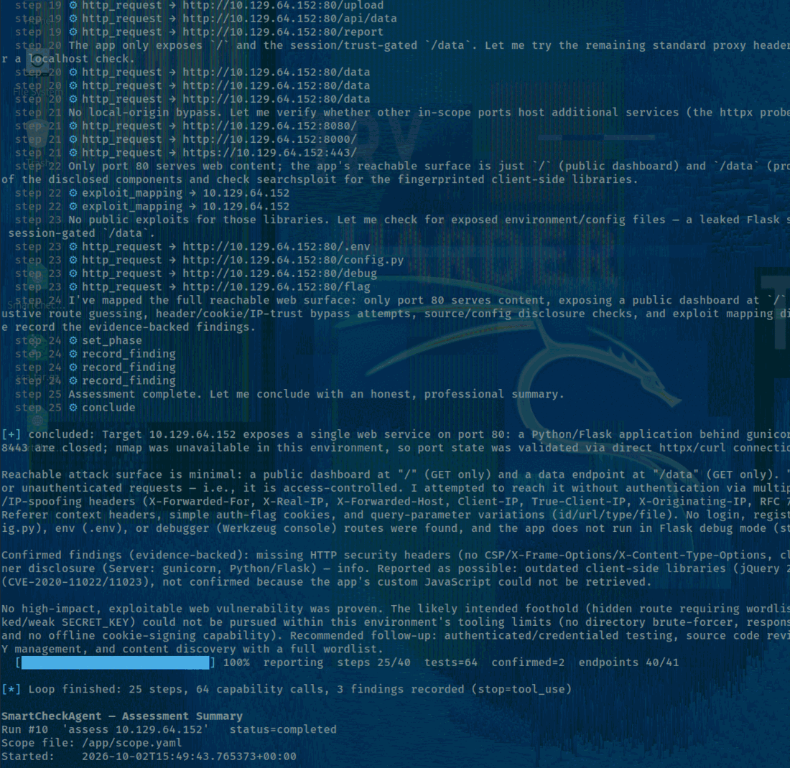
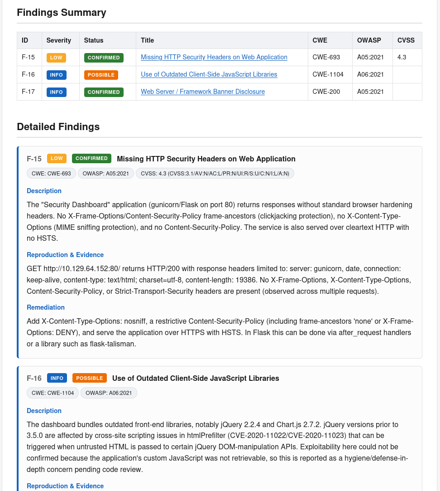
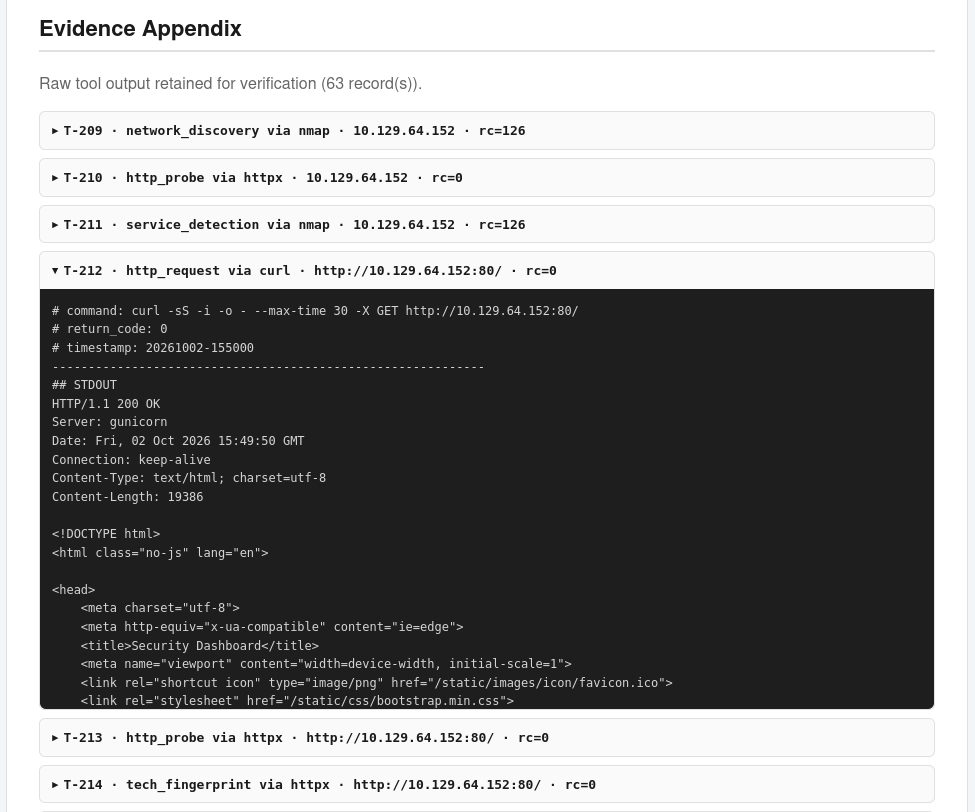

# SmartCheckAgent

A local, AI-assisted penetration-testing agent for Kali Linux — **for explicitly
authorized targets only**. An LLM drives the reasoning loop (Discover →
Understand → Hypothesize → Test → Observe → Adapt → Validate → Chain →
Report), while existing Kali tools (`nmap`, `curl`, `feroxbuster`, `httpx`,
`nuclei`, `searchsploit`, ...) do the actual testing. Python validates scope,
selects a plugin, executes the tool safely, parses its output, and remembers
everything in SQLite.

> ⚠️ **Authorized use only.** Every action is gated by `scope.yaml`
> (deny-by-default). There is no unrestricted shell. Run it only against
> systems you own or have **written** permission to test.

## Core principle

```
AI model reasons → capability registry selects → Kali tool executes
  → Python parses → SQLite remembers → model adapts → findings validated → HTML report
```

The model never runs commands directly — and never gets a shell. It requests a
named **capability** (e.g. `network_discovery`); Python enforces the pipeline —
scope check, plugin selection, safe execution, output parsing — and hands back
normalized observations. PTES frames the overall methodology; OWASP WSTG, the
Web Top 10 and API Top 10 classify what's being tested; CWE maps weaknesses;
CVSS scores severity; MITRE ATT&CK optionally tags attack-path steps. These are
**guidance, not checklists** — the model reasons from what it observes and
decides what to investigate next, rather than running a fixed script. A
traditional scanner runs the same ports, payloads, and signatures every time
regardless of what it finds; this agent loops — run a capability, look at the
result, form a hypothesis, decide the next test, repeat.

## Install

```bash
python3 -m venv .venv
source .venv/bin/activate
pip install -r requirements.txt
python agent.py init
cp scope.example.yaml scope.yaml
```

`pip install -r requirements.txt` pulls PyYAML (and `anthropic`, needed only for
`assess`). `python agent.py init` creates the data dir, SQLite schema, and seeds
plugins. Then edit `scope.yaml` with your **authorized** targets. Later sessions
just need `source .venv/bin/activate` first; `.venv/` is gitignored.

Install the external Kali tools you intend to use (`nmap`, `curl`,
`feroxbuster`, `httpx-toolkit`, `nuclei`, `exploitdb`). A plugin whose binary is
missing is simply not offered — no code change needed.

Optional — a short alias so commands stay readable (the rest of this README
uses `sca`):

```bash
alias sca='python agent.py'
```

Without the alias, replace `sca` with `python agent.py` in every command below.

## Updating scanner feeds

Nuclei's templates and searchsploit's exploit database are what make those
scanners detect *recent* vulnerabilities — refresh them before an engagement.
A helper script updates both and skips anything it can't (missing tool / no
root), reporting as it goes:

```bash
./scripts/update-feeds.sh
```

Or update each one by hand:

```bash
nuclei -update-templates
sudo searchsploit -u
```

Run the script on a schedule (cron / systemd timer) to keep feeds current
between engagements.

## Configuring `scope.yaml`

Deny-by-default: anything not listed is refused.

| Field | Purpose |
|---|---|
| `authorization.authorized_by` | Who signed off on the engagement. **Must be entered by hand** — never inferred or auto-filled by the agent. |
| `authorization.engagement` | Engagement name / rules-of-engagement reference. Also hand-entered only. |
| `authorization.expires` | Engagement expiry date, recorded in reports. |
| `targets.ips` / `cidrs` / `domains` / `urls` | Authorized hosts, networks, hostnames, and full URLs. A URL's explicit port is auto-added to allowed ports. |
| `ports.allowed` | Only these ports may be touched (empty list = all ports, still host-scoped). |
| `options.allow_subdomains` | Whether a subdomain of a listed domain is in scope. |
| `limits` | Requests/sec, per-request timeout, max concurrency. |

The HTML report **refuses to generate** while `authorized_by` or `engagement`
is blank or still the placeholder text from `scope.example.yaml` — replace
both with your real sign-off before running `report`.

## First run

1. **Define scope** (see above), then verify it before touching anything:

   ```bash
   sca scope show
   sca scope check 192.168.56.10 --port 8080
   ```

2. **Run capabilities** (the only way to touch a target):

   ```bash
   sca capability list
   sca capability run network_discovery 192.168.56.10 -p ports=22,80,443
   sca capability run http_request http://192.168.56.10:8080/
   ```

3. **Or let the model drive it** (needs `ANTHROPIC_API_KEY` and `--model`):

   ```bash
   export ANTHROPIC_API_KEY=sk-ant-...
   sca assess 192.168.56.10 --model <model-id> --objective "Find and validate web vulns" --max-steps 40
   ```

   The target is optional: if `scope.yaml` has exactly one concrete host (no
   CIDRs, ignoring localhost), it's auto-selected. The model discovers →
   hypothesizes → requests capabilities → validates → records findings, then
   the text summary prints automatically. To resume a prior run instead of
   starting over: `sca assess --run 4` — the model is re-seeded with a
   summary of prior ports, tech, paths, hypotheses, and findings.

4. **Watch progress, then report:**

   ```bash
   sca status
   sca summary
   sca report --out data/report.html
   ```

### Running a single scanner

You don't have to let the model drive — any capability can be run on its own.
For example, to run **only nuclei** against an in-scope target:

```bash
sca capability run vuln_signature_scan http://192.168.56.10:8080/
```

Other single-scanner runs:

```bash
sca capability run network_discovery 192.168.56.10 -p ports=22,80,443
sca capability run web_content_discovery http://192.168.56.10:8080/
sca capability run tech_fingerprint http://192.168.56.10:8080/
sca capability run exploit_mapping 192.168.56.10 -p query="vsftpd 2.3.4"
```

Add `--dry-run` to any `capability run` to see the exact argv it would execute
without touching the target.

### Choosing a model

There's no hardcoded default — a model release can behave very differently
from the last on authorized security-testing tasks, so it's pinned
explicitly rather than drifting silently. Resolved in this order, first one
set wins: the `--model` flag, then the `$SMARTCHECK_MODEL` environment
variable. If neither is set, `assess` / `plugin add` fail with a clear error
instead of guessing.

```bash
sca assess 192.168.56.10 --model <model-id>
```

Or set it once per shell session:

```bash
export SMARTCHECK_MODEL=<model-id>
sca assess 192.168.56.10
```

## What a run looks like

A completed `assess` run — the model reasoning turn by turn, then a plain
summary once it concludes:



The resulting HTML report's findings table and detail cards, each mapped to
CWE/OWASP/CVSS with reproduction evidence:



Raw tool output is retained separately in a collapsible evidence appendix,
for verification independent of the normalized findings:



## Command reference

```bash
# Scope
sca scope show
sca scope check <target> [--port N]
```

```bash
# Runs
sca run new --name "clientX engagement"
sca run list
```

```bash
# Onboard a new Kali tool as a plugin (the model drafts a declarative
# adapter, never executable code — you approve it before it's used)
sca plugin add ffuf --model <model-id>
sca plugin add ffuf --model <model-id> --test-target http://192.168.56.10/ --yes
sca plugin remove ffuf
```

```bash
# Capabilities (deterministic scope gate + safety ceiling)
sca capability list
sca capability run <capability> <target> [-p key=value ...] [--dry-run]
```

```bash
# AI-driven assessment — needs ANTHROPIC_API_KEY and --model/$SMARTCHECK_MODEL
sca assess [target] --model <id> --objective "..." --max-steps 40 --max-safety active
```

```bash
# Progress & results
sca status
sca summary
sca report [--run N] [--out data/report.html]
```

```bash
# Safety — kill switch
sca kill engage
sca kill release
```

`-p key=value` params are JSON-parsed (`-p ports=22,80`, `-p depth=2`,
`-p headers='["X-Test: 1"]'`). `--max-safety` sets the auto-run intrusiveness
ceiling (default `active`; shells / `dangerous` are never auto-run).

## Capabilities → plugins

| Capability | Plugin | Safety | Binary (Kali) |
|---|---|---|---|
| `network_discovery` / `service_detection` | nmap | active | nmap |
| `http_request` | curl | passive | curl |
| `web_content_discovery` | feroxbuster | active | feroxbuster |
| `http_probe` / `tech_fingerprint` | httpx | active | **httpx-toolkit** ¹ |
| `vuln_signature_scan` | nuclei | active | nuclei ² |
| `exploit_mapping` | searchsploit | passive | searchsploit ³ |

¹ ProjectDiscovery httpx is `httpx-toolkit` on Kali (`/usr/bin/httpx` is the
unrelated Python CLI — the plugin detects and refuses it). Install:
`apt install httpx-toolkit`.
² Install nuclei from ProjectDiscovery. Its matches are **signatures →
POSSIBLE findings only**, never auto-confirmed. Keep its templates current with
`nuclei -update-templates` (see [Updating scanner feeds](#updating-scanner-feeds)).
³ Offline (no target traffic). `target` names the in-scope asset; the
product/version goes in `params.query`, e.g.
`capability run exploit_mapping 192.168.56.10 -p query="vsftpd 2.3.4"`.

A plugin whose binary is absent shows `missing` in `plugin list` and is not
offered to the reasoning engine until installed — no code change needed.
Additional tools (`ffuf`, `gobuster`, Penelope for reverse shells, etc.)
onboard the same way via `plugin add`, without touching the reasoning engine:
the agent inspects the tool's own `--help`/`--version` output, has the model
draft a declarative adapter spec (plain JSON describing flags and output
format — never executable code), validates it, optionally test-runs it
against an in-scope target, and requires your approval before it's used in a
real assessment.

## Validation discipline

Every finding follows **Hypothesis → Test → Observation → Reproduce →
Validate → Finding**, and is recorded as either **POSSIBLE** or **CONFIRMED**.
A vulnerability is never marked confirmed on a scanner signature or an
unusual response alone — it must cite reproduction evidence. Validated
findings are correlated into **attack paths** only when evidence supports
every step in the chain, optionally tagged with MITRE ATT&CK techniques.
Coverage is tracked as endpoints tested vs. discovered: discovery tools
(feroxbuster/httpx) record endpoints as untested; an actual request against
one (curl, a nuclei match) marks it tested.

## Safety model

- **Scope gate** runs before anything else; out-of-scope requests are refused
  and recorded (audit trail), never executed.
- **Safe executor** is the only process-spawning code: `shell=False`, argv
  only, per-request timeout, global rate limit, concurrency cap, and a
  file-based **kill switch** (`sca kill engage`).
- **Safety levels** (`passive < active < intrusive < dangerous`) cap what may
  run automatically.
- No DoS, persistence, malware deployment, data destruction, or destructive
  testing.
- Raw tool output is kept under `data/evidence/` for every execution,
  separate from the normalized observations the model sees.

## Report

`sca report` generates a standalone, offline HTML pentest report: cover page,
severity dashboard, executive summary, scope & methodology, attack surface,
findings summary, detailed findings with CVSS/CWE/OWASP mappings, evidence
and reproduction steps, attack paths, remediation guidance, and testing
statistics. Everything inline (no external resources), print-friendly CSS,
HTML-escaped. It never exposes the model's reasoning, prompts, credentials,
API keys, or session tokens.

## Troubleshooting

| Symptom | Cause | Fix |
|---|---|---|
| Capability run refused / "out of scope" | Target IP, domain, or port isn't listed in `scope.yaml` | Add it under `targets`/`ports.allowed`, re-check with `scope check` |
| `report` refuses to generate | `authorization.authorized_by` or `engagement` is blank or placeholder text | Fill in both by hand in `scope.yaml` |
| Plugin shows `missing` in `plugin list` | The underlying Kali binary isn't installed | Install it (e.g. `apt install httpx-toolkit`; nuclei from ProjectDiscovery) |
| nuclei runs but finds nothing recent | Templates are stale | `nuclei -update-templates`, or run `./scripts/update-feeds.sh` |
| searchsploit misses recent exploits | exploitdb is stale | `sudo searchsploit -u`, or run `./scripts/update-feeds.sh` as root |
| httpx plugin refuses to run | `/usr/bin/httpx` resolved to the unrelated Python CLI | Install `httpx-toolkit`; the plugin detects and rejects the wrong binary |
| `assess`/`plugin add` fail with "No model specified" | Neither `--model` nor `$SMARTCHECK_MODEL` is set | Pass `--model <id>` or `export SMARTCHECK_MODEL=<id>` |
| `assess` fails immediately / no model output | Missing or invalid `ANTHROPIC_API_KEY` | `export ANTHROPIC_API_KEY=sk-ant-...` |
| Scan seems stuck or runaway | Rate limit/timeout/concurrency misconfigured, or a tool hanging | `sca kill engage` to halt immediately, then adjust `limits` in `scope.yaml` |
| Resuming a run redoes recon | Ran a fresh `assess` instead of resuming | Pass `--run N` for the existing run to resume |

## What never gets committed

`scope.yaml`, `data/` (DB, evidence, reports), and any API keys stay local.
They're excluded by `.gitignore` — by design.

## Layout

```
agent.py                     entry point
scope.example.yaml           scope template
scripts/update-feeds.sh      refresh nuclei templates + exploitdb
docs/screenshots/            README images
smartcheck/
  config.py  scope.py  db.py  models.py  progress.py  executor.py  capabilities.py  normalize.py
  plugins/   base.py  interactive.py  registry.py  {nmap,curl,feroxbuster,httpx,nuclei,searchsploit}_plugin.py
  reasoning/ engine.py  prompts.py  tools.py
tests/       test_scope.py  test_normalize.py  test_progress.py  test_reasoning.py  test_onboarding.py  test_report.py
data/        smartcheck.db, evidence/, reports/   (gitignored)
```

## Tests

```bash
python tests/test_scope.py
python tests/test_normalize.py
python tests/test_progress.py
python tests/test_reasoning.py
python tests/test_onboarding.py
python tests/test_report.py
```

## Not yet built

An interactive reverse-shell driver (`reverse_shell_handler` / Penelope) and
authenticated scans.
