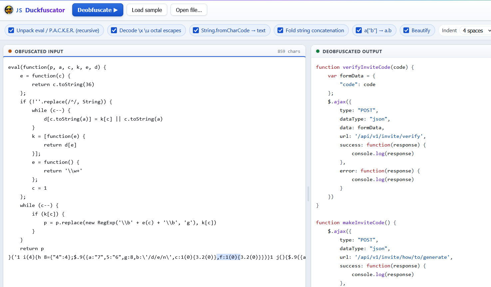

# JS Duckfuscator

Paste obfuscated JavaScript on the left, get readable JavaScript on the right.

It is a single HTML file. Download it, double-click it, done. No install, no npm, no build step, no external scripts, and no network calls — nothing you paste into it leaves your machine.



## Quick start

1. Download `js-deobfuscator.html` and open it in any browser.
2. Paste obfuscated code into the left pane, or click **Open file**.
3. Press `Ctrl+Enter`, or click **Deobfuscate**.

Click **Load sample** to see it work on a known packed script before trusting it with anything real.

## What it handles

| Obfuscation | Looks like | Becomes |
|-------------|-----------|---------|
| Packer wrapper | `eval(function(p,a,c,k,e,d){...}('1 i(4)...',24,24,'response\|function\|...'.split('\|'),0,{}))` | the original source |
| Hex / unicode / octal escapes | `'\x63\x6f\x6e\x73\x6f\x6c\x65'` | `'console'` |
| Character codes | `String.fromCharCode(97,108,101,114,116)` | `'alert'` |
| Split strings | `'a' + 'b' + 'c'` | `'abc'` |
| Bracket lookups | `window['console']['log']` | `window.console.log` |
| Minified layout | one 40,000 character line | indented, highlighted |

Stacked packer layers are unwrapped recursively, up to twelve deep.

## How it works

Six stages run in order. Each one undoes exactly one habit, and passes the code to the next. If a stage finds nothing to do, it changes nothing.


Every stage is a checkbox. That is a debugging tool: if output ever looks wrong, switch stages off one at a time until you find the one responsible. It is also useful deliberately — leave escape decoding off when the exact original bytes matter, like when you are writing a detection signature.

### The packer, specifically

Most packed JavaScript you will meet is the Dean Edwards packer, and it is not encryption. It is compression with the decompressor attached:

- The long quoted string is your program with every meaningful word replaced by a short code.
- The pipe-separated list at the end is the dictionary of real words, in order.
- The function in the middle is a loop that swaps each code back for its word.

Codes count up in base 36, which is why they run `0-9` then `a-z`. So `1` is `function`, `2` is `log`, `3` is `console`, and `3.2(0)` rebuilds to `console.log(response)`.

Worth knowing: **the dictionary is plain text**. Before running any tool, read the word list at the end of the line. In the bundled sample it gives away `verifyInviteCode`, `makeInviteCode`, `api/v1`, `invite` and `generate` — enough to know there is an invite-code endpoint before you decode a thing.

### Why it tokenizes first

Before any stage runs, the file is broken into tokens the way a JavaScript engine does it: strings, numbers, names, comments, regex, punctuation.

Plain search-and-replace gets fooled. The `//` in `https://` is not a comment. A `/` is division in one place and the start of a regex in another. A brace inside a string is just a brace. Working on tokens means a transformation never rewrites the inside of a string literal and hands back broken code that still looks fine.

## Reading the status bar

The bar at the bottom reports what actually fired:

```
Done in 7.0 ms - unpacked 1 eval layer, escapes x12, bracket-to-dot x8
```

If it says `no obfuscation patterns matched, formatted only`, nothing recognizable was found and the code was just reformatted. That is a result too — it means the sample uses one of the techniques below.

## Limits

Not handled:

- Obfuscator.io string arrays and rotators, e.g. `_0x4f2a(0x1b3)`
- Control-flow flattening, a `while` loop wrapped around a large numbered `switch`
- Custom VM and bytecode interpreters
- Renaming mangled identifiers back to anything meaningful

Those need scope analysis over a real syntax tree, which this tool does not build. Run it first anyway — it strips the outer packing in a second and shows you which one you are dealing with.

## Security

Unpacking means running the sample's own unwrapping function, so a small amount of sample-controlled code executes in the browser tab.

What limits that:

- Code is evaluated **only** when it matches the packer signature `function(p,a,c,k,e,d)`. An `eval` holding anything else is left alone and shown to you as-is.
- Only the unwrapper runs. Its return value is captured as text and never executed.
- The page has no network code, so it cannot send a sample anywhere.

For live malware, use a throwaway browser profile with no saved logins, ideally in a VM. Do not open it in the same browser as your mail or client portals, and never paste recovered code into a console to see what it does. Read it.

## Files

| File | Purpose |
|------|---------|
| `js-deobfuscator.html` | The tool. This is the only file you need. |
| `JS-Duckfuscator-Runbook.docx` | Full technical write-up: pipeline, tokenizer, safety model, troubleshooting |

## License

MIT — see [LICENSE](LICENSE).
